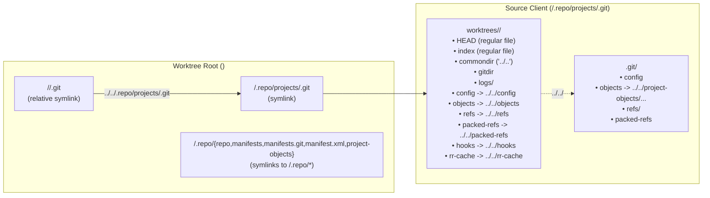
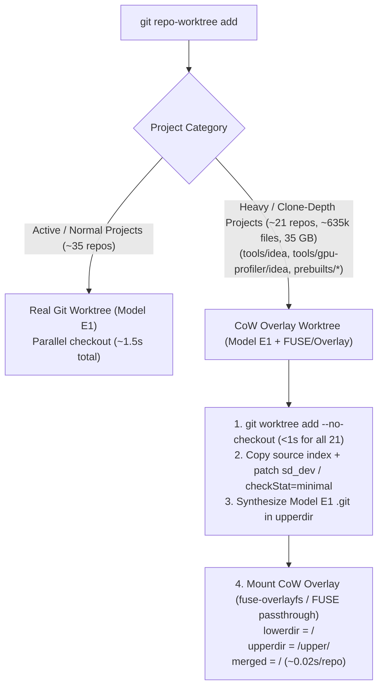

# Architectural Plan: Industrial-Strength `git-repo-worktree` (v2)

This plan details the design revisions required to make [`git-repo-worktree`](../) industrial-strength for both human engineers and autonomous agents—achieving **full `repo` and `repox` command fidelity**, **eliminating the `symlink-shared` source-corruption footgun**, and **smoothing out every operational hoop** in `SKILL.md` without sacrificing creation speed.

---

## 1. Full `repo` & `repox` Fidelity via Synthesized `.repo/` (Model E1)

### 1.1 Why `repo` and `repox` Fail Today (and Why Naive `.repo` Symlinking Fails)
1. **Why `repo` fails today**: `git-repo-worktree` omits `.repo/` in created worktrees ([`spec.md` P1](../spec.md#L15-L18)), and creates `<wt>/<proj>/.git` as a Git worktree pointer file (`gitdir: <source>/.repo/projects/<proj>.git/worktrees/<id>`).
2. **Why `repox` fails today**: `repox/workspace.py` walks parent directories looking for `.repo`, and `discover_git_roots` walks `<repo_root>` with `os.walk(..., followlinks=False)` looking for `.git` in `dirs` or `files`. Without `.repo`, `repox` from the worktree root finds `repo_root = None` and returns `[]`.
3. **Why naive `ln -s <source>/.repo <wt>/.repo` fails catastrophically** (verified in `/tmp/spike-repo-fidelity`):
   * **`repo branches` and `repo upload` read the wrong `HEAD`**: In `project.py:803-807`, `Project.CurrentBranch` reads `self.bare_ref.head`, which reads `.repo/projects/<path>.git/HEAD` (NOT `<worktree>/<path>/.git/HEAD`!). If `.repo/projects/<path>.git` points to the source client's project gitdir, `repo branches` and `repo upload` inside the worktree report and upload the **source client's branch** instead of the worktree's branch!
   * **`repo sync -l` destroys worktree `.git` pointer files**: In `project.py:_InitGitWorktree` (`lines 4691-4739`), `_removeBadGitDirLink()` checks `os.path.realpath(dotgit) != os.path.realpath(self.gitdir)`. If `<wt>/<path>/.git` is a `gitdir:` file or points anywhere other than `<wt>/.repo/projects/<path>.git`, `repo sync -l` **deletes `<wt>/<path>/.git`** and replaces it with a symlink to the source client's gitdir!
   * **Git's `is_git_directory()` rejects symlinked `HEAD`**: Git's `setup.c:validate_headref()` uses `lstat("<gitdir>/HEAD")` and requires `S_ISREG(st.st_mode)` (a regular file) or a valid `ref:` inside a regular file—never a symlink.

### 1.2 The Verified Solution: Model E1 (Unified Worktree Gitdir Bridge)

#### Exact Layout & Invariants of Model E1
1. **Top-level `<wt>/.repo/` directory**:
   * `<wt>/.repo/project-objects` $\rightarrow$ symlink to `<source>/.repo/project-objects`
   * `<wt>/.repo/repo` $\rightarrow$ symlink to `<source>/.repo/repo`
   * `<wt>/.repo/manifests` $\rightarrow$ symlink to `<source>/.repo/manifests`
   * `<wt>/.repo/manifests.git` $\rightarrow$ symlink to `<source>/.repo/manifests.git`
   * `<wt>/.repo/manifest.xml` $\rightarrow$ symlink to `<source>/.repo/manifest.xml` (or the pinned manifest)
   * `<wt>/.repo/project.list` $\rightarrow$ generated list of project paths in the worktree
2. **Per-project `<source>/.repo/projects/<path>.git/worktrees/<wt_id>/` augmentation**:
   * After `git worktree add` creates `<source>/.repo/projects/<path>.git/worktrees/<wt_id>/` (containing regular files `HEAD`, `index`, `commondir`, `gitdir`, and `logs/`), `git-repo-worktree` adds relative symlinks inside `worktrees/<wt_id>/` for shared gitdir entries (`config`, `objects`, `refs`, `packed-refs`, `hooks`, `rr-cache`, `info`, `description`, `.repo_config.json` $\rightarrow$ `../../*`), and sets `worktrees/<wt_id>/gitdir` to `<wt>/<path>/.git\n`.
3. **Per-project `.repo/projects` and `.git` symlinks inside `<wt>`**:
   * `<wt>/.repo/projects/<path>.git` $\rightarrow$ symlink to `<source>/.repo/projects/<path>.git/worktrees/<wt_id>`
   * `<wt>/<path>/.git` $\rightarrow$ relative symlink `../../.repo/projects/<path>.git` (matching standard `repo` layout!).
   * *(Note: If the source client itself was initialized with `repo init --worktree`, Repo natively uses `.repo/worktrees/<name>.git` and `gitdir:` files; symlinking `<wt>/.repo/worktrees -> <source>/.repo/worktrees` works natively without even converting `.git` to a symlink!)*

#### Why Model E1 Is Industrial-Strength (Verified in `/tmp/spike-repo-fidelity`)
* **Single `HEAD` and `index`**: Both `git` and `repo` (`bare_ref.head` and `work_git`) read and write the **exact same regular file `HEAD` and `index`** inside `worktrees/<wt_id>/`! Switching branches via `git checkout -b`, `git switch`, or `repo start` is immediately visible to both `git` and `repo`.
* **Survives `repo sync -l`**: Because `realpath(<wt>/<path>/.git) == realpath(<wt>/.repo/projects/<path>.git)`, `repo sync -l`'s `_removeBadGitDirLink()` check passes with zero changes to `repo`!
* **Preserves Git multi-worktree branch locks**: `git -C <source>/<path> worktree list` still sees `<wt>/<path> [branch]`, and Git still prevents checking out the same branch in two worktrees simultaneously.
* **Lifecycle note for `remove` / `repair`**: Because `git worktree remove` / `git worktree repair` checks that `<wt>/<path>/.git` is a regular file (`gitdir: ...`) before removing, [`remove_worktree_registration`](../src/tree.rs#L1940-L1974) and [`run_repair_command`](../src/tree.rs#L1720-L1847) will restore the `gitdir:` regular file before invoking `git worktree remove`/`repair` (and re-create the relative symlink after `repair`).
* **Also fix `<extend-project>` in [`src/manifest.rs:327-365`](../src/manifest.rs#L327-L365)**: Parse `<copyfile>` and `<linkfile>` under both `<project>` and `<extend-project>` elements.

---

## 2. Eliminating `symlink-shared` Without Sacrificing Speed

### 2.1 Empirical Benchmark Results on `studio-main` (Linux 7.1.6, `ext4` without reflink)

We benchmarked all candidate strategies on `/usr/local/google/home/jomof/projects/studio-main` (`tools/idea`: 274,366 files, 2.0 GB, 44 MB index; `prebuilts/studio/jdk`: 7.2 GB; and all 56 projects):

| Strategy | Populate Time | `git status` (Cold / Warm) | Source Isolation | Why / Tradeoff |
| :--- | :--- | :--- | :--- | :--- |
| **1. Full `git worktree add` (`tools/idea` only)** | **114.3 s** | 15.7 s / 6.4 s | Full | Too slow for 660k files on `ext4` (no `FICLONE` reflink). |
| **2. Hardlink Farm (`cp -al` on `tools/idea`)** | **89.4 s** | **Thrash!** | **Broken (`O_WRONLY`)** | **Disqualified**: `link(2)` updates `st_ctime` on all 274k source inodes, invalidating `studio-main`'s Git index stat cache! Also `O_WRONLY` mutates source files. |
| **3. `git worktree add --no-checkout` + Index Copy (ALL 56 projects, 16x parallel)** | **1.06 s total** (`0.86s` worktree + `0.21s` index copy) | Instant (with `skip-worktree` / sparse) | Full Git isolation | Creates real Git worktrees for all 56 repos in **1.06s**, serving as the foundation for CoW overlay mounts. |
| **4. `fuse-overlayfs` CoW + `checkStat=minimal` / `sd_dev` Index Patch** | **0.019 s** (`tools/idea`) **0.230 s** (`jdk` 7.2 GB) | `diff-files`: **0.012 s** Warm `status`: **12.8 s** (**2.96 s** `-uno`) `remove` dirty check: **0.05 ms** | **100% CoW Isolated** (`realpath` stays in `<wt>`) | Patching `sd_dev` (or setting `core.checkStat=minimal` + `core.trustctime=false`) eliminates the `st_dev` mismatch (`253,1` vs `0,334`) so Git does **zero** file reads/hashes! Also removes the 5.5 GB `<copyfile>`/`<linkfile>` demotion penalty on `prebuilts/studio/sdk/linux`. |
| **5. Built-in Rust FUSE (`fuser` + Linux 6.9+ `FUSE_PASSTHROUGH` + RAM Stat Arena)** | **~0.02 s per heavy project** | **1.5–3.0 s** cold & warm `remove` dirty check: **0.05 ms** | **100% CoW Isolated + Drift Immune** | Serves `lookup`/`getattr` from an in-memory `ls-tree`/index arena (`attr_timeout=86400s`), passes file `read`/`mmap` directly to kernel `ext4` via `FUSE_PASSTHROUGH`, and falls back to `.git` packfile blobs if `studio-main` switches branches. |

### 2.2 Recommended Tiered Isolation Architecture (Zero `symlink-shared`)

1. **Every project in the worktree gets a real Model E1 `.git` worktree** (`git worktree add --no-checkout` takes **0.86s** across all 56 projects in parallel!).
   * No project ever shares `studio-main`'s `.git/HEAD` or `.git/index`.
   * Every project is visible to `repo`, `repox`, `git`, `rg`, and `fd` as a real directory (not a symlink), so `realpath(<wt>/<proj>/...)` **always stays inside `<wt>`** and `os.walk` traverses it normally!
2. **Normal projects (~35 projects in `studio-main`)**:
   * Checked out normally in parallel via `git worktree add --detach` (~1.5–2.0 seconds total).
3. **Heavy / `clone-depth` projects (`prebuilts/*`, `tools/idea`, `tools/gpu-profiler/idea` — ~21 projects, 35 GB)**:
   * Mounted via **Copy-on-Write FUSE Overlay (`fuse-overlayfs`)** (Phase 2a) and optionally upgraded to the **built-in Rust `fuser` + `FUSE_PASSTHROUGH` daemon** (Phase 2b):
     * `lowerdir`: `<source>/<proj>` (read-only view; mutations in `<wt>` never touch `<source>`!)
     * `upperdir`: `<source>/.repo/repo-worktrees/<id>/overlays/<proj>/upper` (stores any CoW file edits/creations/whiteouts, plus the Model E1 `.git -> ../../.repo/projects/<proj>.git` symlink).
     * `workdir`: `<source>/.repo/repo-worktrees/<id>/overlays/<proj>/work`.
     * Mount point: `<wt>/<proj>`.
   * **Instant `status` / `remove` Dirty-Check Optimization (< 50 µs)**:
     * In `git-repo-worktree status` and `remove`, before running `git status --porcelain` on an overlay-mounted heavy project, `git-repo-worktree` checks `readdir(upperdir/<proj>)` (ignoring `.git`).
     * If `upperdir/<proj>` has **zero other entries**, no file in the overlay was ever written or deleted—so `git-repo-worktree` knows the working tree is 100% clean in **< 0.05 milliseconds** without stating 274,366 files!
   * **Auto-Remount & Clean Unmount Lifecycle**:
     * `git-repo-worktree remove` / `prune`: cleanly runs `fusermount3 -u <wt>/<proj>` (falling back to `-uz`) before deleting `<wt>`.
     * `git-repo-worktree doctor` / `repair`: detects if a reboot unmounted FUSE mounts and automatically re-mounts them in ~0.3s while preserving all edits in `upperdir`.
     * `git-repo-worktree materialize <tree> <proj>`: unmounts the CoW overlay, checks out the remaining files from Git, and overlays any in-flight `upperdir` edits on top so edits made before `materialize` are preserved.

---

## 3. Smoothing Out All 8 Operational Hoops from `SKILL.md`

### 3.1 Workspace Environment Bootstrapping & Safe `env.bazelrc` Isolation (Hoop 1)
* **Problem**: Missing `env.bazelrc` drops `--config=rcache` (38,000-action rebuild), while naive `cp env.bazelrc` copies `startup --output_base=/google/cartfs/mount/82f1a270dd3e54436acdeaa58b68077a`, hijacking `studio-main`'s Bazel server!
* **Design Revision**:
  * During `reconcile_links_and_copies` ([`src/tree.rs:1390`](../src/tree.rs#L1390)), automatically detect untracked workspace-root environment files (`env.bazelrc`, `.bazelrc.user`, `local.properties`, plus any patterns in `.repo/repo-worktrees/config.json`).
  * For `*.bazelrc` files (`env.bazelrc`), copy all lines **except** rewrite or strip `startup --output_base=<path>`:
    * If `<path>` is on a fast mount (e.g. `/google/cartfs/mount/<hash>`), rewrite it to a worktree-isolated sibling path `/google/cartfs/mount/<hash>-wt-<tree_name>` (if writable) or comment out `startup --output_base=...` so Bazel assigns the worktree its own isolated `output_base` while keeping `build --config=rcache` and `startup --max_idle_secs=10800`!
  * Record the synthesized `env.bazelrc` in `meta.json` so `remove` can cleanly remove it and shut down the worktree's Bazel server (`bazel --batch ... shutdown` or killing the worktree's Bazel server PID).

### 3.2 Spelling Out By-Design Starting Revisions in `--help` & Docs (Hoop 2)
* **Problem**: Agents are sometimes confused about whether `git repo-worktree add` checks out remote `goog/studio-main` or the initiating repo's current commits.
* **Design Decision**:
  * **Preserve the by-design behavior**: A created worktree is initialized to the detached `HEAD` commits of the initiating `repo` client (`repo manifest -r`), matching standard `git worktree add --detach` semantics.
  * **Remediate agent confusion in `--help` and docs**: Explicitly spell out in [`src/cli.rs`](../src/cli.rs) (`about` / `long_about` for `add` and top-level CLI help, which also generates the `git-repo-worktree(1)` manpage), [`skill/SKILL.md`](../skill/SKILL.md), and [`spec-user-journeys.md`](../spec-user-journeys.md) that every project in a newly created worktree starts at the detached `HEAD` of the initiating `repo` workspace by design.

### 3.3 Scoped Branch Creation with Upstream Tracking (Hoop 3)
* **Problem**: `add -b <branch>` creates `<branch>` in all 57 projects without upstream tracking (`branch.<name>.remote` / `branch.<name>.merge`), breaking `repox -hb`, `repo upload`, and `repox stack`.
* **Design Revision**:
  * When `-b <branch>` is passed:
    1. If `--project` or `--full-project` is specified, create `<branch>` **only** in those requested projects (leaving all other projects detached at base revision).
    2. If `-b <branch>` is passed *without* `--project` / `--full-project`, require `--all-projects` to create a branch across all 57 repos, or error with `E_BRANCH_NEEDS_PROJECT_SCOPE` explaining to pass `-p <proj>` or use `repo start <branch> <proj>` inside the worktree.
    3. Whenever creating a branch in `<proj>`, automatically configure:
       * `branch.<branch>.remote = <manifest_remote>` (e.g. `goog`)
       * `branch.<branch>.merge = <manifest_upstream>` (e.g. `refs/heads/studio-main`)
       matching `repo start` (`project.py:StartBranch`).

### 3.4 Resolving the Branch-Lock Trap (`detach` & `--steal-branch`) (Hoop 4)
* **Problem**: `fatal: '<branch>' is already used by worktree at ...` when switching branches between `studio-main` and a worktree.
* **Design Revision**:
  * Add `git repo-worktree detach [<tree>|source] [--branch <branch>] [--project <proj>]`:
    * Finds any project in `<tree>` (or in the primary `source` checkout) currently on `<branch>` (or all non-detached branches if `--branch` is omitted), verifies or optionally stashes uncommitted changes, and runs `git checkout --detach HEAD` to free the branch lock.
  * Add `--take-branch <branch>` (or allow `add -b <existing-branch> --steal`) which automatically detaches the clean holder worktree/source before checking out `<branch>` in the new worktree.
  * Surface `checked_out_branches: [{"project": "tools/adt/idea", "branch": "my-feature"}]` in `list --json` and `status --json`.

### 3.5 Subpath-to-Project Resolution & Idempotent `materialize` (Hoop 5)
* **Problem**: Passing `tools/vendor/google/android-apk` to `--full-project` or `materialize` fails with `E_UNKNOWN_PROJECT`; calling `materialize` on an already-materialized project fails with `E_NOT_SHARED`.
* **Design Revision**:
  * Add a central helper `resolve_project_query(manifest_projects, cwd_rel, input_path) -> ResolvedProject`:
    1. Exact match on `project.path` or `project.name`.
    2. Longest-prefix match where `input_path` is a subdirectory inside `project.path` (e.g., `tools/vendor/google/android-apk` $\rightarrow$ `tools/vendor/google`).
    3. Path relative to current working directory when invoked from a subdirectory.
  * Make `git repo-worktree materialize <tree> <proj...>` **idempotent**: if `<proj>` is already in `worktree` mode, return `status: "already_materialized"` with exit code `0`.

### 3.6 Fixing `git repo-worktree --help`, Binary Shadowing & CLI/Skill Sync (Hoops 6 & 7)
* **Design Revision**:
  * Update [`install.sh`](../install.sh) to:
    1. Copy the generated `git-repo-worktree.1` manpage from `target/release/build/git-repo-worktree-*/out/git-repo-worktree.1` to `${MAN_DIR:-$HOME/.local/share/man/man1}/git-repo-worktree.1` so `git repo-worktree --help` works immediately.
    2. Check if another `git-repo-worktree` binary exists earlier on `PATH` (such as `~/.cargo/bin/git-repo-worktree`) and either update/remove the stale binary or print a prominent warning.
  * Add CLI ergonomics aliases in [`src/cli.rs`](../src/cli.rs):
    * Accept `--full-all` as a visible alias for `--full` on `add`.
    * Accept `defaults set <proj> <worktree|symlink|auto>` and `defaults unset <proj>` alongside `defaults worktree|symlink|auto <proj...>`.
  * Update both [`skill/SKILL.md`](../skill/SKILL.md) and `~/projects/repox/personal/skills/repo-worktree/SKILL.md` so all flags, JSON schemas, and error codes match 100%.

### 3.7 Safe Teardown (`remove` Unbranched Commit Guard, Bazel Shutdown & Structured `E_DIRTY`) (Hoop 8)
* **Design Revision**:
  * In [`project_is_dirty`](../src/tree.rs#L2295-L2317):
    * Check both `git status --porcelain` AND whether a detached `HEAD` has commits not reachable from any branch (`git rev-list HEAD --not --branches --remotes` or `HEAD != pinned_revision && not_on_any_branch`).
  * When `remove` fails with `E_DIRTY`:
    * Populate structured `error.details.dirty_projects` (never truncate to 10 in JSON!) with `{ "path": "...", "uncommitted_files": 3, "unbranched_commits": 1 }`.
  * Before removing a worktree directory in [`run_remove_command`](../src/tree.rs#L1849-L1974):
    1. Unmount any FUSE CoW mounts under `<wt>`.
    2. Shut down any Bazel server JVM whose workspace root is `<wt>` (and clean up any worktree-specific `output_base`).

---

## 4. Implementation Roadmap

| Phase | Scope | Key Files Modified | Verification Target |
| :--- | :--- | :--- | :--- |
| **Phase 1: Full `repo` & `repox` Fidelity (Model E1)** | Synthesize `<wt>/.repo/`, augment `worktrees/<id>/` with gitdir symlinks, replace `.git` gitfile with relative symlink `../../.repo/projects/<path>.git`, support `<extend-project>`, update `remove`/`repair`/`doctor` to handle Model E1 `.git` symlinks. | [`src/tree.rs`](../src/tree.rs), [`src/manifest.rs`](../src/manifest.rs) | Integration tests verifying `repo status`, `repo branches`, `repo start`, `repo diff`, `repo forall`, `repo upload --dry-run`, `repo sync -l`, and `repox -hc` / `repox -hb` inside a worktree. |
| **Phase 2: CoW FUSE Overlay Isolation (Replacing `symlink-shared`)** | Replace `SymlinkShared` with `CowOverlay` (`git worktree add --no-checkout` + index copy + `sd_dev` patch / `core.checkStat=minimal` + `fuse-overlayfs` mount + `upperdir` O(1) dirty check + clean unmount in `remove`/`prune` + remount in `repair`/`doctor`; optional Phase 2b built-in Rust `fuser` + `FUSE_PASSTHROUGH` daemon). | [`src/tree.rs`](../src/tree.rs), [`src/model.rs`](../src/model.rs) | Benchmark `add` on `studio-main` (< 5s total); verify editing or running `git` inside `<wt>/tools/idea` or `<wt>/prebuilts/*` never touches `studio-main`; verify `realpath` stays in `<wt>`. |
| **Phase 3: Workspace Configs, `--help` Docs, Scoped `-b`, & `detach`** | Auto-copy `env.bazelrc` with `startup --output_base` isolation; spell out detached-`HEAD`-of-initiating-repo semantics in `--help` (`src/cli.rs`) and docs; scope `-b` to `-p`/`--full-project` with upstream tracking config; add `detach` subcommand; subpath resolution; idempotent `materialize`. | [`src/cli.rs`](../src/cli.rs), [`src/tree.rs`](../src/tree.rs), [`src/defaults.rs`](../src/defaults.rs) | Unit + integration tests for `env.bazelrc` rewriting, `add -b feat -p proj` tracking config, `detach`, and subpath resolution. |
| **Phase 4: Safe Teardown, Manpage Install & Skill Sync** | Unbranched-commit guard & structured `E_DIRTY` details; Bazel server shutdown on `remove`; manpage installation & PATH shadow check in `install.sh`; update `spec*.md` and `SKILL.md`. | [`install.sh`](../install.sh), [`src/error.rs`](../src/error.rs), [`skill/SKILL.md`](../skill/SKILL.md) | `cargo test` passes 100%; `git repo-worktree --help` opens manpage; `remove` catches detached unbranched commits. |
